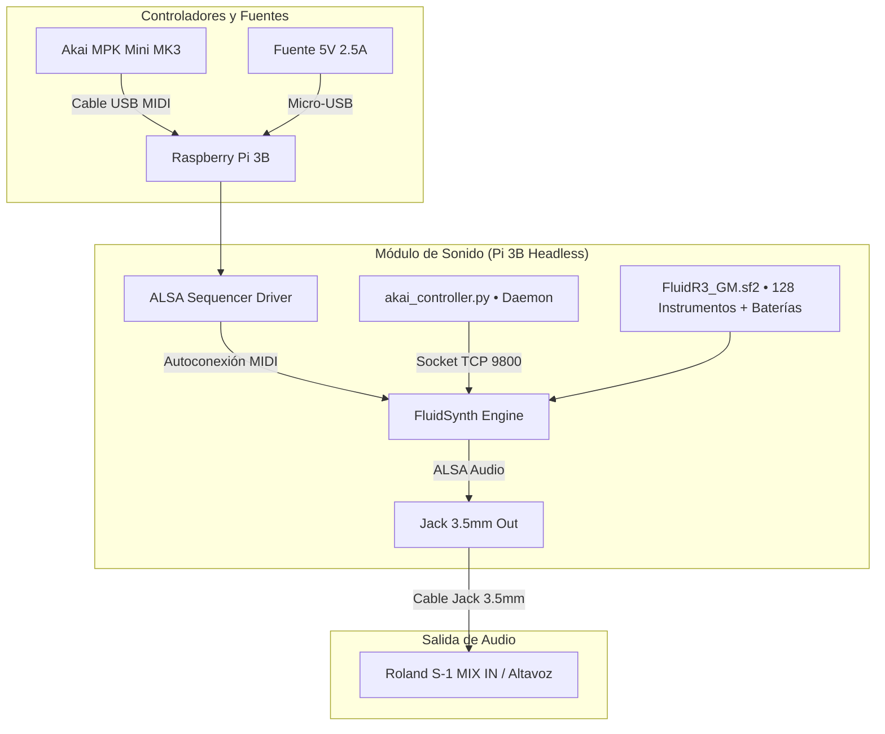
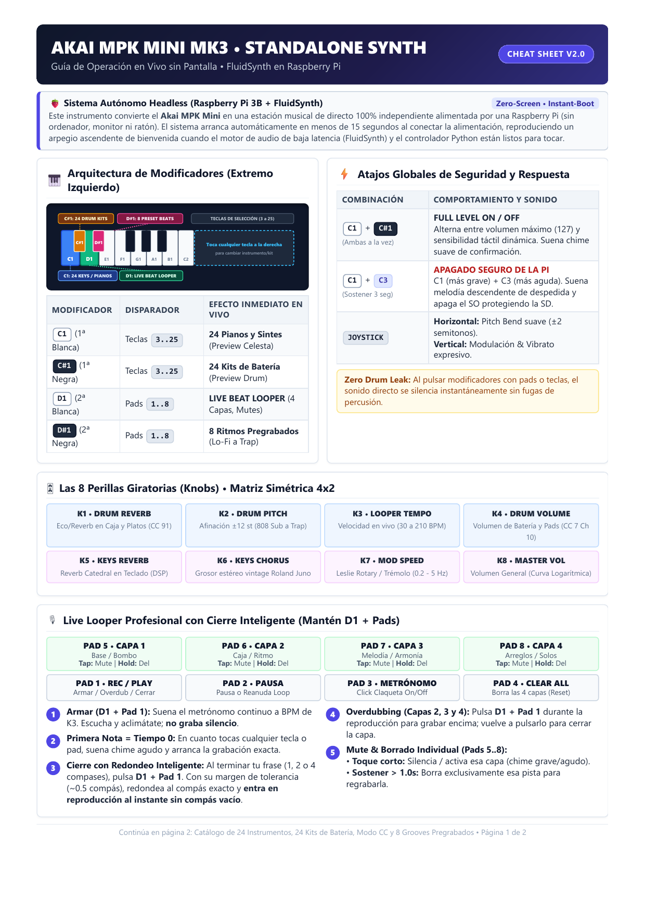
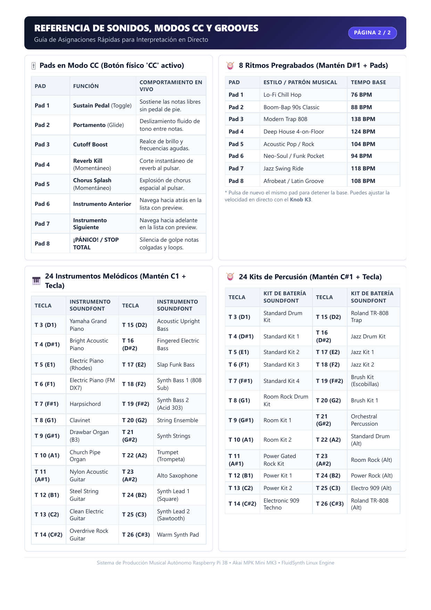
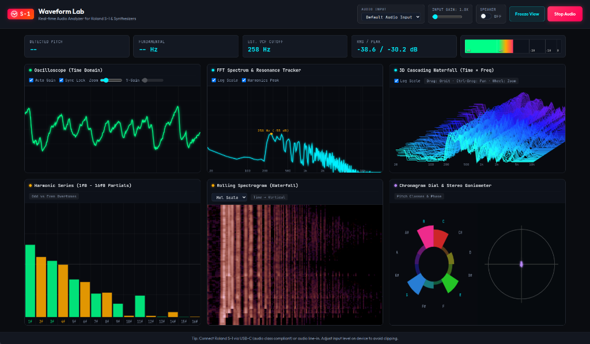

# Sintetizador Autónomo Raspberry Pi 3B + Akai MPK Mini MK3 (FluidSynth Standalone)

> 🌐 **Live Web Waveform Visualizer (Roland S-1 & Synths):** [https://carrommad.github.io/midi-to-synth/](https://carrommad.github.io/midi-to-synth/)

Convierte tu **Raspberry Pi 3 Model B (v1.2)** en una estación de sonido y ritmos independiente, con arranque automático sin monitor ni ratón (*zero-screen*), controlada al 100% desde el teclado, perillas y pads del **Akai MPK Mini MK3** (compatible también con MK2).

---

## Especificaciones del Hardware & Sistema

| Componente | Detalle Verificado |
|---|---|
| **Placa** | Raspberry Pi 3 Model B Rev 1.2 (Quad-Core Cortex-A53 @ 1.2 GHz, 1 GB RAM) |
| **Sistema Operativo** | **Raspberry Pi OS (Debian GNU/Linux 13 "Trixie")** |
| **Arquitectura** | **64-bit (`arm64` / `aarch64`)** |
| **Kernel** | `Linux 6.12.75+rpt-rpi-v8 #1 SMP PREEMPT` |
| **Controlador MIDI** | **Akai MPK Mini MK3 / MK2** (USB Class-Compliant) |
| **Motor de Sonido** | **FluidSynth** (ALSA Audio, baja latencia, procesador de efectos reverb y chorus activos) |
| **Salida de Audio** | Salida Jack 3.5mm estéreo hacia Roland S-1 (MIX IN) / Auriculares / Altavoces |

---

## Arquitectura del Sistema



---

## Manual de Instrucciones en PDF (2 Páginas A4)

Puedes consultar o imprimir el manual visual maquetado con esquemas vectoriales de las teclas y atajos:
* 📄 **[Manual de Instrucciones Akai MPK Mini (PDF)](docs/Manual_Instrucciones_Akai_MPK_Mini.pdf)**
* 🌐 **[Código fuente del manual (HTML)](docs/manual_akai_mpk.html)**
* 📋 **[Mapeo técnico detallado (Markdown)](docs/MIDI_MAPPING_AKAI.md)**

<p align="center">
  
  
</p>

---

## Guía Rápida de Operación en Vivo

### Rotulación Física del Teclado (Marcas sobre las Teclas):
| Marca | Tecla Física | Acción / Función |
|---|---|---|
| **`[F]`** | **$C2$** + **$B3$** (ambas a la vez) | **Full Volume**: Mantén 2s `[F]` $C2$ (blanca izq) + `[F]` $B3$ (penúltima blanca der) para 100% volumen |
| **`[—]`** | **$C2$** + **$C4$** (ambas a la vez) | **Line Shutdown**: Mantén 3s los dos extremos `[—]` $C2$ + `[—]` $C4$ para apagar la Raspberry Pi |
| **`[S]`** | **$C\#2$** (1ª negra izquierda) | **Sets (Drums Sets)**: Mantén `[S]` + Pads 1..8 para elegir 16 Drum Sets (Bank A: 1..8, Bank B: 9..16; Pad 8 Bank A: Flamenco) |
| **`[L]`** | **$D2$** (2ª blanca izquierda) | **Looper**: Mantén `[L]` + Pads 1..8 para control del Live Looper de 8 pistas |
| **`[P]`** | **$D\#2$** (2ª negra izquierda) | **Presets**: Mantén `[P]` + Pads 1..8 para disparar los 16 Ritmos pregrabados |

---

### 1. Modificadores y Selección
* **`[S]` ($C\#2$, 1ª Negra) + Pads (1 a 8)**: Elige entre **16 Drums Sets** (Bank A: 1..8, Bank B: 9..16) con prueba sonora inmediata al soltar la tecla:
  - **Bank A**: 1. Standard, 2. Room Rock, 3. Electronic 909, 4. Roland TR-808, 5. Power Rock, 6. Jazz, 7. Brush (Escobillas), **8. Flamenco Cajón & Palmas Kit**.
  - **Bank B**: 9. Orchestra Percussion, 10. Standard 1, 11. Standard 2, 12. Standard 3, 13. Room 1, 14. Room 2, 15. Power 1, 16. Analog Dance / Electro 808.
* **`[L]` ($D2$, 2ª Blanca) + Pads (1 a 8)**: Control completo del **LIVE BEAT LOOPER (8 Pistas)**:
  - `Pad 1`: Armar metrónomo / Cuantización / Auto-cierre de 4 compases / Overdub.
  - `Pad 2`: Conmutar modo **Re-Voice** (Bloqueo de instrumento por pista vs Re-Voice global).
  - `Pad 3`: Metrónomo click On / Off.
  - `Pad 4`: Toque corto: **Play / Pause** | Sostener > 1.5s: **Borrado Total de Pistas**.
  - `Pads 5 a 8`: **Control de Pistas 1 a 4 (Bank A) y 5 a 8 (Bank B)** (Tap: Mute toggle; Hold >1s: Borrado individual).
* **`[P]` ($D\#2$, 2ª Negra) + Pads (1 a 8)**: **16 Ritmos Pregrabados** listos para improvisar (8 en Bank A, 8 en Bank B) con Auto-Sync BPM desde Arpegiador.
* **Pads 6 + 7 juntos durante 2s (Modo CC)**: Activa el **Modo Selección por Teclado** donde las 25 teclas físicas eligen directamente entre los 25 sonidos del set melódico activo. Al soltar los pads, las teclas vuelven de inmediato a tocar notas.

---

### 2. Atajos Globales de Teclado & Hardware
* **`[F]` $C2$ + `[F]` $B3$ (Sostener 2s)**: Alterna el modo **FULL VOLUME / FULL LEVEL** del teclado (100% volumen fijo vs curva dinámica táctil).
* **`[—]` $C2$ + `[—]` $C4$ (Sostener 3s)**: **Apagado Seguro** de la Raspberry Pi con chime descendente.
* **`PROG SELECT` / `PROG CHANGE`**: Conmuta el silenciado global de chimes auxiliares.
* **Switchable Magic Pad (`magic_pad.py`)**:
  - *Toque de 3 dedos*: Cicla entre **Theremin Glide**, **Kaoss Pad FX** (X=Cutoff, Y=Reverb) y **Vector Morpher** (X=Pan, Y=Chorus).
  - *Barrido horizontal de 4 dedos*: Izquierda a derecha avanza instrumento; derecha a izquierda retrocede instrumento.
* **Joystick 4 direcciones**:
  - *Horizontal*: Pan estéreo (CC 10).
  - *Vertical*: Modulación (CC 1) y Cutoff (CC 74).

---

### 3. Matriz Simétrica 4x2 de los 8 Knobs
* **Fila Superior (Batería y Looper)**:
  - `K1`: **Drum Reverb Splash** (CC 91 caja y platos).
  - `K2`: **Drum Pitch Tuning** (Afinación &plusmn;12 semitonos).
  - `K3`: **Looper Tempo** (Control de velocidad en vivo de 30 a 210 BPM).
  - `K4`: **Drum Volume** (Volumen de batería y pads en CC 7 Ch 10).
* **Fila Inferior (Teclado y Master)**:
  - `K5`: **Keys Reverb Eco** (Reverberación catedral en teclado).
  - `K6`: **Keys Chorus Lush** (Grosor vintage Roland Juno).
  - `K7`: **Dual Mode: Sustain Decay / Rotary Vibrato**:
    - *Con Sustain ON* (`Pad CC 1` o pedal activo): Control de **Tiempo de Caída/Sustain** (1s a 60s en pianos y acústicos para resonancia natural completa; 1s a 35s en órganos y sintes continuos para evitar drones colgados).
    - *Con Sustain OFF*: **Velocidad de Giro Rotary / Vibrato Leslie** (0.2 Hz a 5.0 Hz con enganche automático de profundidad y modulación).
  - `K8`: **Master Volume** (Volumen general de todo el sistema).

---

### 4. Modo CC en los Pads (Botón físico 'CC' activo)
* `Pad 1`: **Pedal de Sustain** (Toggle para mantener notas flotando sin pedal de pie).
* `Pad 2`: **Portamento / Glide** (Deslizamiento fluido de tono entre notas ligadas).
* `Pad 3`: **Cutoff Boost** (Apertura de filtro y brillo al 100%).
* `Pad 4`: **Reverb Kill** (Corte momentáneo de reverb mientras se pulsa).
* `Pad 5`: **Chorus Splash** (Explosión de chorus espacial mientras se pulsa).
* `Pad 6`: **Instrumento Anterior** (con preview sonoro).
* `Pad 7`: **Instrumento Siguiente** (con preview sonoro).
* `Pad 8`: **¡Pánico / Stop Total!** (Toque corto: silencia notas colgadas y vacía reverb | Sostener 2.0s: **Performance Lock** que silencia chimes y anula 100% las funciones en las teclas, incluido el apagado, para tocar en directo sin riesgos).

---

## Roland S-1 Waveform Lab (Analizador Web de Audio en Tiempo Real)

El repositorio incluye un laboratorio visualizador de audio en tiempo real diseñado específicamente para sintetizadores analógicos/virtuales como el **Roland S-1 Tweak Synth** (compatible con audio USB-C class-compliant o entrada de línea/jack).

* 🌐 **Acceso Web en Vivo (GitHub Pages):** [https://carrommad.github.io/midi-to-synth/](https://carrommad.github.io/midi-to-synth/)
* 🚀 **Ejecución local rápida:** `./visualization/run.sh`

<p align="center">
  <a href="https://carrommad.github.io/midi-to-synth/">
    
  </a>
</p>

### Características de Gráficos e Instrumentación
1. **Osciloscopio (Dominio Temporal):** Sincronización robusta por cruce por cero (*Sync Lock*), auto-ganancia suave con umbral antirruido y control manual de V-Gain / Zoom.
2. **Espectro FFT & Tracker de Resonancia:** Escala logarítmica (20 Hz a Nyquist), detección automática de frecuencia de corte VCF / pico armónico con rechazo de zumbido eléctrico (< 80 Hz).
3. **Cascada 3D Waterfall (Tiempo × Frecuencia):** Proyección isométrica tridimensional con 180 líneas de persistencia, escala logarítmica y navegación interactiva (Órbita, Desplazamiento y Zoom).
4. **Serie Armónica Discreta (1f₀ - 16f₀):** Desglose individual de sobretonos pares e impares con memoria de tono y decaimiento visual suave.
5. **Espectrograma Continuo de Calor:** Cascada temporal vertical con auto-escalado AGC dinámico.
6. **Dial de Cromagrama & Goniómetro Estéreo:** Rueda de clases de tono de 12 semitonos con umbral de silencio y osciloscopio de fase estéreo.
7. **Monitor de Altavoces & Medidor Broadcast:** Conmutador directo de altavoz portátil y vúmetro calibrado con indicador persistente de saturación (**CLIP**).

---

## Estructura del Repositorio

```text
midi-to-synth/
├── README.md                      # Esta guía central
├── docs/
│   ├── Manual_Instrucciones_Akai_MPK_Mini.pdf  # Manual imprimible de 2 páginas A4
│   ├── manual_akai_mpk.html                    # Fuente HTML del manual visual
│   ├── MIDI_MAPPING_AKAI.md                    # Mapeo y arquitectura técnica de notas
│   ├── ROLAND_S1_INTEGRATION.md                # Guía de integración con Roland S-1
│   ├── FASE_A_FLUIDSYNTH.md                    # Documentación de instalación base
│   └── OPTIMIZACION_LATENCIA.md                # Parámetros ALSA y buffers de baja latencia
├── scripts/
│   ├── akai_controller.py         # Daemon principal (Looper, modificadores, routing, apagado)
│   ├── start-synth.sh             # Script de arranque del servicio FluidSynth
│   ├── synth.service              # Unidad de servicio Systemd para boot headless
│   ├── install_fluidsynth.sh      # Script de aprovisionamiento de dependencias
│   └── select_sound.sh            # Utilidad CLI para selección por terminal
└── visualization/
    ├── index.html                 # Interfaz visual del Waveform Lab
    ├── styles.css                 # Sistema de diseño, temas dark y layout responsive
    ├── app.js                     # Motor Web Audio API (doble analizador FFT, algoritmos DSP)
    ├── favicon.svg                # Favicon estilizado Roland S-1
    └── run.sh                     # Lanzador de servidor local
```


---

---

## 🔒 Seguridad de Red y Control del Motor (Puerto 9800)

FluidSynth abre un shell interactivo de control en el puerto TCP `9800`. Para evitar accesos no autorizados desde la red local (Wi-Fi), el puerto está aislado a nivel de kernel mediante reglas persistentes de `iptables`:
- **Tráfico local (Loopback / `127.0.0.1`):** `ACCEPT` (usado por `start-synth.sh` y scripts internos de control).
- **Tráfico externo (Wi-Fi / LAN):** `DROP` (bloquea cualquier sondeo o comando entrante desde la red doméstica).
- **Persistencia:** Gestionado por `netfilter-persistent` (`/etc/iptables/rules.v4`).

---

## 🛠️ Directivas y Lecciones Aprendidas de FluidSynth & Audio

1. **Rango Estricto de Velocidad de Chorus/Vibrato**:
   - El comando de FluidSynth `cho_set_speed` **sólo admite valores entre 0.10 y 5.00 Hz**. Enviar valores superiores (e.g., 6.0 Hz u 8.0 Hz) provoca el rechazo del comando por el motor de audio y deja la modulación congelada o inaudible.
2. **Dependencia de Cadena de Efectos (FX Bus Sends)**:
   - Los parámetros de modulación dinámica (como velocidad o profundidad) requieren que el canal de mezcla húmeda (`cc 0 93`), el nivel general (`cho_set_level`) y la profundidad (`cho_set_depth`) estén activos (>0). No asumir que otra perilla estará subida.
3. **Envolventes de Caída: Instrumentos Acústicos vs Continuos**:
   - **Pianos y cuerdas percutidas**: La resonancia natural de las muestras acústicas puede durar 30s a 45s. Limitar el temporizador de sustain a valores inferiores corta la cola de forma no musical. El techo debe ser amplio (hasta 60s).
   - **Órganos, pads y sintes sostenidos**: Como las muestras son bucles infinitos, requieren un temporizador estricto (techo de 35s) para silenciar la voz y evitar la saturación de polifonía de la CPU.
4. **Permisos de Ejecución (`+x`)**:
   - Los scripts del servicio (`scripts/start-synth.sh`) deben conservar siempre el bit ejecutable rastreado en Git (`git update-index --chmod=+x scripts/start-synth.sh`) para evitar errores `203/EXEC` en systemd tras un pull.
